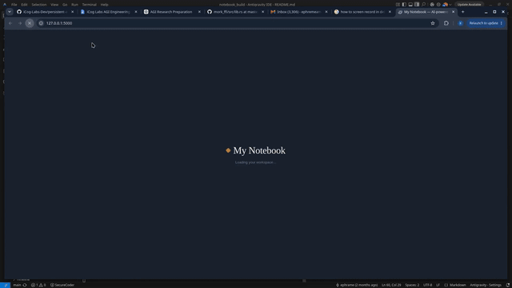

# Marginal — a place to think with your sources

A NotebookLM-style RAG app: drop in PDFs/text files, chat with
them, and get answers with clickable numbered citations that jump to the
exact source passage. Generate audio overviews of your documents — as a
two-host podcast or a single-narrator summary — powered by Edge-TTS. Hybrid
retrieval (semantic + keyword) under the hood, fully visible and editable.

## What makes this different from a toy RAG demo

- **Multiple sources per notebook** — not one document at a time.
- **Real conversation** — multi-turn chat with history, not single Q&A.
- **Citations, not just "here are some chunks"** — the model is prompted to
  cite `[1]`, `[2]`... and the UI turns those into clickable chips that
  scroll to and highlight the exact passage they came from, with its
  semantic/keyword/fused scores visible.
- **Source management** — see every indexed document with its chunk count,
  remove one without rebuilding the whole notebook.
- **Audio overviews** — generate a two-host podcast discussion or a
  single-narrator summary of your notebook, synthesised with Edge-TTS.
  Listen directly in the browser.
- **A real interface** — three-pane layout (sources / chat / source
  inspector), not a single form.

## Architecture

```
core/
  chunking.py       recursive character splitter (hand-written, tunable)
  embeddings.py      local sentence-transformer or Gemini API embeddings
  bm25.py            keyword search, from-scratch inverted index + BM25
  vectorstore.py     ChromaDB or Supabase storage facade
  supabase_store.py  Supabase Postgres + pgvector storage
  retriever.py       fuses dense + sparse scores (tunable alpha)
  chat_history.py    short rolling conversation memory per notebook
  rag_pipeline.py    ingestion + citation-aware prompt building + LLM call
  audio_generator.py script generation (LLM) + Edge-TTS synthesis + MP3 concat
app.py               Flask routes (sources, chat, audio, notebooks)
templates/index.html three-pane UI: sources rail / chat / citation inspector
```

## Setup

```bash
python -m venv venv
source venv/bin/activate        # Windows: venv\Scripts\activate
pip install -r requirements.txt

cp .env.example .env
# edit .env and add your GEMINI_API_KEY (https://aistudio.google.com/apikey)

python app.py
# open http://localhost:5000
```

## Run with Docker

Docker Compose uses the local embedding model and Chroma via
[`Dockerfile.local`](Dockerfile.local).

```bash
cp .env.example .env   
docker compose up --build
# open http://localhost:5000
```

## Free hosted demo: Render + Supabase

The hosted build uses **Supabase Postgres with pgvector** for source passages and
**Gemini Embedding 2** for 768-dimensional vectors. It does not install PyTorch,
sentence-transformers, Chroma, or LangChain. The original local stack remains
the default when `RAG_MODE=local`; its Chroma data is not migrated automatically.

1. Create a Supabase project. In its SQL Editor, run
   [`sql/supabase.sql`](sql/supabase.sql) once.
2. In Supabase **Connect**, copy the **Transaction pooler** Postgres URI. Keep
   this URI private. It is the value for `SUPABASE_DB_URL`.
3. Push this repository to GitHub and create a Render **Blueprint** from it.
   [`render.yaml`](render.yaml) selects the small hosted Docker image and free
   web service. The default [`Dockerfile`](Dockerfile) also selects the hosted
   build if you create a Docker web service manually. Enter `SUPABASE_DB_URL`
   when Render prompts you; Render generates `FLASK_SECRET_KEY`. For a manual
   web service, set both values in Render's environment settings.
4. Open the Render URL. Each tester enters **their own Gemini API key** in the
   app before uploading a document or asking a question. The key is sent with
   each request and is not stored by the app. This keeps your own key from
   covering every tester's embedding and chat usage.

The hosted demo caps files at 5 MB, 80 passages per file, and five sources per
notebook. Uploading unchanged content under the same filename reuses its saved
embeddings. A signed browser cookie keeps each tester's notebooks separate;
there is no login or recovery if they clear that cookie. Source passages stay
in Supabase, while chat history and generated audio are temporary on Render.
The free Render service can sleep when idle, so its first request may take time.

To run the hosted profile locally after creating the Supabase table:

```bash
python -m venv .venv-hosted
source .venv-hosted/bin/activate
pip install -r requirements-hosted.txt
RAG_MODE=hosted SUPABASE_DB_URL='your-postgres-uri' FLASK_SECRET_KEY='a-long-random-secret' SESSION_COOKIE_SECURE=false python app.py
```

The Gemini embedding model name can be overridden with
`GEMINI_EMBEDDING_MODEL`, but switching models requires re-embedding sources
because their vectors are not comparable. The database schema assumes 768
dimensions.

## Test

```bash
python app.py            # in one terminal
python test_app.py       # in another
```

## Demo

[](static/demo.mp4)

- 🎬 **[Watch Demo Video (MP4)](static/demo.mp4)**
- 🎧 **[Listen to Sample Audio Overview (MP3)](static/audio_generated.mp3)**


